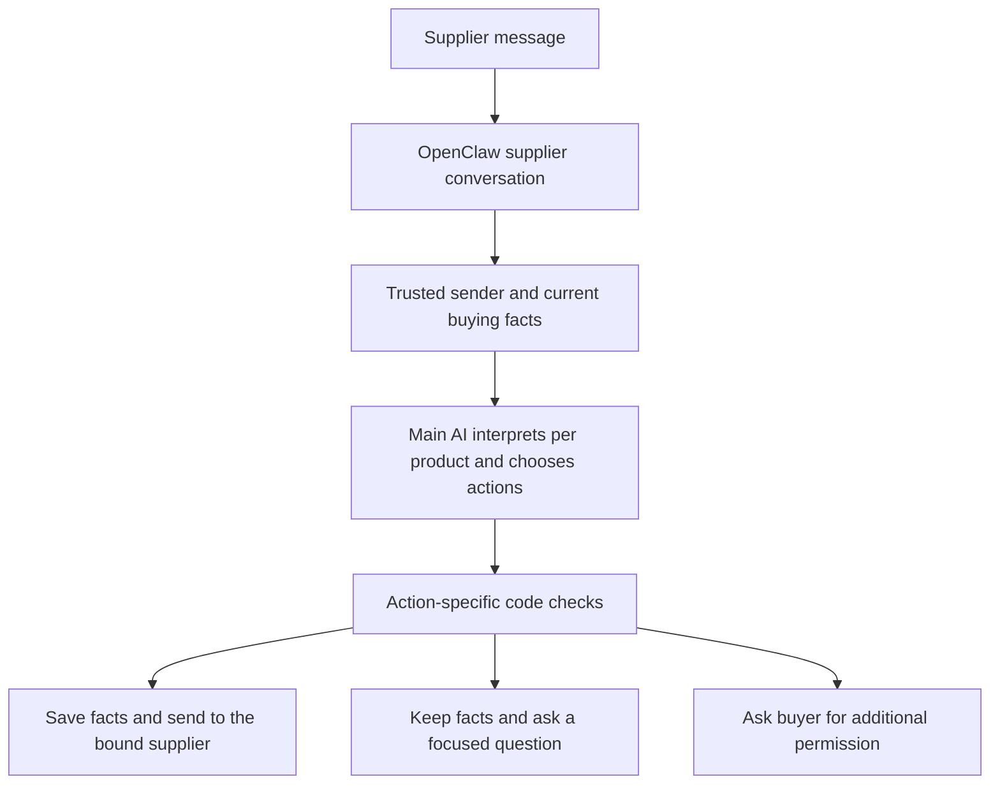

# Amafah conversation and decision-model handoff

Snapshot: 7 November 2026. This is a reusable project handoff, not proof of production behavior or permission to deploy. Written in plain language so the owner can review it and another coding agent can resume the work.

## User's decision

**Now:** use the existing main AI to understand messages, select the relevant RFQ, negotiate and write replies. Reuse each supplier's OpenClaw conversation. Add no paid classifier or model-hosting requirement.

**Later:** consider Jev plus the main AI. Jev would handle narrow classification and RFQ-selection questions so the main AI receives clearer context and may do less repeated work. It is deferred because the user has no budget for it now. Do not install or activate Jev, Kev, another hosted service, or a new local model merely because this document is loaded.

The user wants natural conversations, fewer unnecessary checks, and fewer tokens. Supplier, RFQ, recipient and purchase permissions still need real protection. Classification being the largest token cost is a hypothesis; it has not been measured.

## Resume from the actual code

1. Find the current repositories and read their applicable instructions. Paths have changed during this work. At this snapshot the backend is `/Users/hussainmukadam/Desktop/Mohammad Mukadam/amafah-purchase-manager-ai-agent`; its separate OpenClaw Git repository is nested at `openclaw-railway-template/`.
2. Inspect Git status and existing diffs before editing. There are extensive uncommitted changes, including removal of legacy Groq code and tests. Preserve that work; do not treat deleted tests as proof that coverage is adequate.
3. Backend HEAD: `a48b941`. Wrapper HEAD: `68c297b` (preserve model choice during startup). Recheck these; they are landmarks, not required versions. Pushing or deployment of that wrapper fix was not confirmed.
4. Local source and live Railway may differ. OpenClaw is pinned to 2026.10.1 in the reviewed Dockerfile. Verify installed runtime APIs and plugin hook behavior before using current online documentation as an exact implementation contract.
5. This handoff does not implement the new architecture. At creation, only documentation was changed by this request.

### Files to inspect

| File | What it owns |
|---|---|
| `openclaw_bridge.py` | Activation, supplier/RFQ lookup, quotation recording, commercial checks, acceptance, drafts and delivery reconciliation |
| `db.py`, `supplier_message_planner.py`, `negotiation_engine.py` | Saved records, multi-product validation and commercial calculations |
| `main.py`, `auth.py` | Buyer APIs, identity/role checks, reminders, dispatch and reports |
| `openclaw-railway-template/plugins/procurement-tools/dist/index.js` | 17 registered business tools and incoming/outgoing message hooks |
| `openclaw-railway-template/plugins/procurement-tools/openclaw.plugin.json` | Plugin declarations; check consistency with registrations and permitted tools |
| `openclaw-railway-template/src/server.js` | Gateway supervisor, setup, proxy, system sending and analysis endpoints |
| `openclaw-railway-template/src/procurement-analysis.js` | Separate JSON analysis runs for extraction and ranking in the local migration |
| `supabase/migrations/` | Database approval and atomic-write functions; verify live application separately |

Schema changes must follow the repository's AGENTS.md migration process. Avoid schema changes where existing context and action interfaces suffice.

## Important facts and current gaps

- Startup sets `session.dmScope = "per-channel-peer"`. One supplier/channel has its own continuing session; it is not a new session per message or necessarily one session per RFQ. Confirm effective live configuration. If multiple WhatsApp accounts are introduced, examine account isolation before assuming this scope is sufficient.
- OpenClaw can retain conversation, but older context can be summarized or omitted. History is evidence, not current buying permission. Recovery still needs saved business records.
- `/supplier-context` fetches database history (default 20 messages). `/resolve-rfq-context` additionally retrieves messages and quotations per candidate. This can duplicate context already present in OpenClaw.
- The activation gate uses keyword patterns. Replies such as "24" or "agreed" may be rejected before semantic interpretation despite an ongoing buying discussion.
- `procurement_validate_rfq_mapping` is registered and requested by instructions, but missing from the normal WhatsApp tool allowlist and the manifest's tool list. Fix the inconsistency as part of any revised flow.
- The single-quote record endpoint checks ownership, active status and invitation scope, but does not require evidence that a separate semantic-mapping check succeeded.
- `_require_current_bundle_rfq` can reject identical active product requests when there is no distinguishing invitation reference. Do not simply remove ambiguity protection; replace unnecessary rejection with evidence-based interpretation or a focused question.
- Tool supplier IDs can be model-supplied. Checking business ownership alone does not bind them to the actual WhatsApp sender.
- Missing sender identity currently gives a prompt warning, rather than the same explicit denial used elsewhere.
- The final sending hook blocks tracked activation denials and recognizable provider errors. Missing outbound log association warns but permits sending. It does not call the exact commercial-approval claim endpoint.
- Existing approval helpers or endpoints do not prove the transport uses them. Follow actual callers.
- Main conversation and separate backend-triggered analysis runs both contribute model work. Do not add a separate classification call if the same main-model turn can do the job.

## Immediate design: main AI + OpenClaw history

### Changes to implement when requested

1. Establish business, WhatsApp account, sender and conversation from trusted channel metadata. Resolve the supplier through the existing supplier records. Do not infer identity by stripping digits from an arbitrary session name or accepting a model-selected supplier ID. Investigate WhatsApp identifier variants and failed historical mappings. Return a specific identity-link problem when unresolved.
2. Give the model one small packet of current supplier/RFQ facts in the existing conversation turn. Reuse the OpenClaw transcript; normally omit duplicate database message history. Verify the actual hook's transcript access. Never assume `event.prompt` is only the latest supplier text.
3. Retain direct reply/invitation evidence. For multiple RFQs, provide meaningful candidate descriptions and saved terms. The main AI interprets uncertain language using conversation. One eligible RFQ alone does not prove an unrelated message concerns it.
4. Classify and act per product. A message can contain a price for lights and unavailability for fans. Do not combine one global RFQ answer with an independently selected global intent.
5. Allow read-only questions and recording known facts without requiring every field needed to accept a deal. Preserve incomplete quotations or drafts using supported storage. A missing delivery date should lead to a delivery question, not loss of a valid price.
6. Consolidate overlapping lookups and remove duplicated instructions. Do not remove a commercial check until equivalent enforcement exists in the action path. Keep ordinary conversation flexible; assess authority when an actual price commitment or acceptance is proposed.
7. Bind saving and sending to the originating supplier and selected RFQ(s). Backend success must not imply successful WhatsApp delivery. Require current authority for binding commitments. An approval of structured terms does not verify arbitrary generated wording; initially use controlled confirmation wording for binding terms while leaving ordinary conversation natural.
8. Measure model calls, input/output/cached tokens where reported, tool calls, retries and completion time. Compare whole-message totals, including analysis sub-runs. Mark missing usage unknown; do not invent percentages for mixed-purpose calls.

### Keep unchanged in purpose

- Existing main model/provider choice unless separately requested.
- OpenClaw as WhatsApp transport and conversation owner.
- Buyer authentication and business isolation.
- Saved suppliers, RFQs, quotations, revisions, approvals and delivery records.
- Buyer limits, automation pause, exact-quote acceptance checks and relevant database transactions.
- Duplicate-message protection and truthful reporting of failed saves/sends.
- Railway hosting arrangement; no paid classifier, GPU deployment or mass history migration.

Do not promise unchanged implementation details: small changes may be needed to preserve these behaviors while removing duplicate work.

## Deferred design: Jev + main AI + history

Jev receives the latest message, bounded relevant conversation, trusted supplier identity, actual eligible RFQ descriptions and direct reply evidence. It does not fetch OpenClaw history itself.

Use supplied candidates plus explicit unclear/no-match outcomes. For messages with several products, evaluate each candidate/product's relationship and intent separately. Keep RFQ uncertainty distinct from intent uncertainty. A supplier can clearly be negotiating while the intended RFQ remains unknown.

The main AI handles complicated conditions, negotiation and natural language. Backend code supplies facts, enforces allowed actions and binds the recipient. A predicted route never authorizes a purchase. Supplier agreement is not buyer authorization.

Jev Choice confidence and selected-option probability are different. Do not hardcode "80% confidence = safe." Evaluate thresholds per task, ambiguity and action risk. High probability is not independent evidence. Independent questions in one request do not consume one another's answers; sequence dependent questions or combine their results explicitly in code.

### Playground evidence to preserve

These were user-run synthetic examples, not a controlled benchmark. Exact full input, revisions, rounding and hosting overhead were not always visible. Do not claim production accuracy from them.

| Example | Kev-4B observation | Kev-0.8B observation |
|---|---|---|
| "24 is final" after a lights negotiation | Correct visible choices; initial model heading not shown | Correct RFQ/type; weak route probability |
| "24 is final" with two RFQs and no history | Correct UNCLEAR RFQ, probability 0.78 | Guessed lights, probability 0.73 |
| Conversation switches from lights to fans; supplier agrees to 85 for 50 | Fans 1.00; agreement 0.79; agreement-check route 0.75 | Fans 0.87; wrong revised-offer type 0.40; wrong save route 0.29 |
| Agreement conditional on ordering 100 rather than 50 fans | Fans 1.00; revised offer 0.85; negotiation 0.94 | Answers not shown |
| Lights priced, fans out of stock in the same message | FAILED: lights 0.72 + unavailable 0.75 + answer/clarify 0.35 | Not shown |

The multi-product failure is the central design warning: independently predicted labels can combine into a wrong business action. Preserve this regression case. Classification did not demonstrate extraction of exact changed terms.

Displayed Kev-4B GPU times in later tests were about 1.2–1.6 seconds; they are not end-to-end application latency. Token figures were 572–832 input tokens for those individual synthetic tests, not production supplier-message totals.

### Future evaluation and rollout

Use reviewed real conversations, with facts available at the message's time and no later replies revealing the answer. Include duplicate products, switched topics, no-context replies, mixed languages, negation, conditional agreement, multiple RFQs, quote revisions, repeated messages and stale permissions. Keep development and unseen evaluation cases separate.

Measure correct matches, confidently wrong matches, unnecessary clarification, preserved conditions, per-item results, latency and total cost. First run without writes or sending, then observe live inputs without controlling actions. Retain main-AI fallback. Do not rely on a free public demo as a production endpoint.

No decision-model provider was selected for production. User lacks budget; hosted access and free allowances must be checked again when resuming. The user's Mac was observed as M3 Pro/18 GB; do not assume Kev-4B fits the project's documented 32 GB Mac path.

## Verification before calling an implementation complete

- Compare current and new flows using the same inputs and model.
- Show supplier/session isolation and rejection of cross-supplier IDs.
- Correctly handle product switches, missing context and multiple products.
- Preserve known prices while asking only for missing details.
- Do not interpret conditional agreement as unconditional acceptance.
- Respect buyer pause and changes made while the model is thinking.
- Replayed messages do not duplicate business actions or sends.
- Check actual outgoing recipient and commercial terms, not only a successful review response.
- Verify saved records and delivery status; use no real supplier messages in tests without authorization.
- Report local checks and live checks separately; state any remaining gap.

## Reference links: verify current contracts before implementation

- OpenClaw sessions: https://docs.openclaw.ai/concepts/session
- OpenClaw history access and limits: https://docs.openclaw.ai/concepts/session-tool
- OpenClaw context: https://docs.openclaw.ai/concepts/context
- OpenClaw token accounting: https://docs.openclaw.ai/reference/token-use
- Jev questions: https://docs.typesafe.ai/primitives/choice
- Jev uncertainty: https://docs.typesafe.ai/confidence
- Jev current models/pricing: https://docs.typesafe.ai/models
- Kev code/evaluation: https://github.com/jaredpalmer/kev

OpenClaw sessions are not automatically OpenAI Conversations API objects. Subscription sign-in does not establish access to supplier histories through the OpenAI Conversations API. Shared model/runtime names do not establish shared storage or permission.
